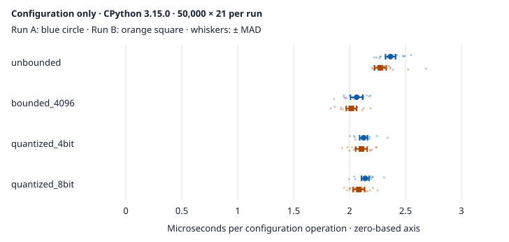

# Portable MLX Configuration Profiling Study

**Version**: 1.1 | **Status**: Same-host fresh-process replication; independently audited | **Date**: 2026-10-19

## Scope and claim boundaries

This protocol measures Python configuration setup only: constructing `MLXConfig`,
serializing it with `to_dict()`, and validating/resolving generation kwargs with
`get_generation_kwargs()`. It does not instantiate a native cache or load a model.
Scenario names describe requested configuration, not demonstrated backend support.
The fresh-process record below publishes configuration observations with raw
samples and provenance. Independent-host replication and production-model
benchmarking remain open. Same-host repetition is not independent-host evidence.

Native inference is `not_run` and Metal memory is `not_measured`. This study cannot
establish token throughput, prefill/decode latency, attention correctness,
long-context recall, device-memory savings, or native MLX support on Python 3.15.
It does not compare Python versions causally. Portable configuration tests and
opt-in tiny-model cache regressions are separate evidence, not production-model
benchmark replications.

## Reproduction

### Local exploratory baseline

The locally reviewed Python 3.15.0 bundle is
`output/mlx-profile-20261017-reviewed`, collected with 50,000 iterations and
21 repeats. Its manifest hashes were verified. It records HEAD
`6fedfa54334e7575f7fcfe6c25ac7e24b6ac3572`, `source_dirty=true`, and hashes of
the measured source files. The later `output/mlx-profile-20261017-final` bundle
records the final renderer hash; the reviewed bundle predates that renderer
correction. Neither retains a complete source snapshot or transitive dependency
freeze. These are local exploratory baselines, not an
independently reproduced or production inference benchmark. The uncommitted
source hashes identify only those files, not the complete historical execution
environment; HEAD alone does not identify dirty source.

### Collection command

Run from the repository root, selecting a new output location for each run:

```bash
uv run --python 3.15 --script scripts/llm/mlx_profile.py \
    --output-dir output/mlx-profile-study --iterations 2000 --repeats 7
```

The script requires Python 3.15 or newer. Its PEP 723 inline dependency metadata
selects portable Python dependencies without requesting `mlx` or `mlx-lm`.
This avoids the native MLX `cp315` packaging constraint for this config-only
workflow; it does not solve or test native packaging compatibility. Dependency
resolution may require network access; the resulting report is offline.

Unset `MLX_MAX_KV_SIZE`, `MLX_KV_BITS`, and `MLX_PREFILL_STEP_SIZE` before running;
the collector rejects their presence, even if empty. It also rejects an already
active `tracemalloc` session or CPU profiler rather than taking ownership of
caller instrumentation.
Active trace functions and monitoring tools are also rejected. Under coverage,
collect in an uninstrumented subprocess so tracing does not contaminate timing.
Explicit synthetic model/cache paths prevent user model selection and do not
load weights or write a model cache. `RUN_LIVE_MLX=1` is not required.

### 2026-10-19 fresh-process replication

Two new processes used an isolated CPython **3.15.0** environment on macOS
**27.0.1 arm64** and the same
frozen, clean source revision **37f86c35adb81a2bc39ac67f04b6dd0885734620**,
which includes the completed #588, #594 and #598 integration. Each process used
**50,000 iterations × 21 repeats** per scenario, plus the documented separate
profiling/allocation passes. Collection ran from **15:27:04 to 15:27:28 UTC**.
The retained record is `output/mlx-replication-20261019`; no shared project
environment was modified. A separate environment was used for validation.

The [public JSON receipt](mlx-profiling-replication-20261019.json) contains both
complete raw profile reports, path-minimized execution receipts, all **28**
installed dependency versions, **113** imported project-source hashes per run,
the exact collection driver, dependency freeze and envelope manifest. Absolute
interpreter paths are omitted from the public projection only. The original
receipts, exact **34 MiB** source archive, extracted source and installed environment
remain local; the archive can be reconstructed from the recorded Git revision.
The bundle is not a wheel archive or hermetic operating-system image.



| Requested configuration | Run A, median ± MAD (µs/op) | Run B, median ± MAD (µs/op) | Traced Python batch peak, both runs |
| --- | --- | --- | --- |
| Unbounded | 2.366 ± 0.046 | 2.275 ± 0.053 | 1494 bytes |
| Bounded 4096 | 2.063 ± 0.055 | 2.016 ± 0.046 | 1742 bytes |
| 4-bit KV requested | 2.125 ± 0.035 | 2.106 ± 0.052 | 1742 bytes |
| 8-bit KV requested | 2.140 ± 0.034 | 2.083 ± 0.052 | 1742 bytes |

Only A/B are treated as a compatible pair: workload, effective settings, source
archive/import hashes, complete dependency set, interpreter binary/build,
platform, clock and process-isolation mode match. This means compatible for
descriptive repeatability, not controlled causal attribution. Absolute between-run
median differences are **0.90–3.83%**, relative to A. Individual samples and
median/MAD are shown together; whiskers are not confidence intervals.

The host was busy with unrelated GitVault/project activity: one-minute load
averages were approximately **33–35**; thermal state, frequency and affinity were
uncontrolled. Samples also show within-run drift: the unbounded scenario's
first-ten/last-ten medians were **2.385/2.340 µs** in A and **2.312/2.250 µs**
in B. The leading cumulative CPU paths in both were `_exercise`, `_configuration`,
dataclass construction and `__post_init__`; traced batch peaks agreed exactly.
These observations do not isolate a cause, establish significance, or justify
changing configuration validation or the conservative cache/prefill protections.

Historical timings are **excluded** from performance comparisons. The final
17 October bundle's three selected source hashes and seven direct dependency
versions match, but its transitive environment, complete imported source closure,
interpreter binary hash and isolation mode were not retained. The earlier
reviewed bundle additionally has a different renderer hash. Missing evidence is
not reconstructed from today's environment or inferred from HEAD. No historical
speedup/regression percentage is reported.

### Frozen-source reproduction and integrity checks

Use the GitVault repository lease for setup, collection and project gates in a
managed checkout. For example, run a reviewed local script through
`/path/to/gitvault/_tools/vault --wait with-repo --label mlx-replication docxology/codomyrmex -- /bin/bash /absolute/path/to/reproduce.sh`.
The lease does not grant publication authority; source changes still use feature
branches and PRs. Never reuse the shared `.venv`, overwrite old bundles or remove
locks. No bootstrap/enrichment or native model download is needed.

The following shell body reconstructs the **measured revision**, not whichever
version happens to be checked out. Inspect the collection driver embedded in the
receipt before executing it. Choose a fresh absolute destination; dependency
installation may use the network and is outside the timed workload.

```bash
set -eu
RECEIPT="$PWD/docs/modules/llm/mlx-profiling-replication-20261019.json"
RUN="$PWD/output/mlx-independent-NEW"
REV=37f86c35adb81a2bc39ac67f04b6dd0885734620
mkdir "$RUN"
git status --porcelain=v1 > "$RUN/git-status.txt"
test ! -s "$RUN/git-status.txt"
git rev-parse HEAD > "$RUN/checkout-head.txt"
printf '%s\n' "$REV" > "$RUN/revision.txt"
git archive --format=tar -o "$RUN/source.tar" "$REV" \
    src scripts/llm/mlx_profile.py pyproject.toml uv.lock
mkdir "$RUN/source"
tar -xf "$RUN/source.tar" -C "$RUN/source"
python3 - "$RECEIPT" "$RUN" <<'PY'
import hashlib
import json
import sys
from pathlib import Path

receipt = json.loads(Path(sys.argv[1]).read_text())
root = Path(sys.argv[2])
assert hashlib.sha256((root / "source.tar").read_bytes()).hexdigest() == receipt["source_archive_sha256"]
driver = receipt["reproduction"]["collection_driver"]
freeze = receipt["reproduction"]["requirements_freeze"]
assert hashlib.sha256(driver.encode()).hexdigest() == receipt["driver_sha256"]
assert hashlib.sha256(freeze.encode()).hexdigest() == receipt["freeze_sha256"]
for name, contents in (("collect.py", driver), ("requirements.freeze.txt", freeze)):
    with (root / name).open("x") as handle:
        handle.write(contents)
PY
uv venv --python 3.15 "$RUN/venv"
uv pip install --python "$RUN/venv/bin/python" -r "$RUN/requirements.freeze.txt"
uv pip freeze --python "$RUN/venv/bin/python" > "$RUN/resolved.freeze.txt"
cmp "$RUN/requirements.freeze.txt" "$RUN/resolved.freeze.txt"
for name in run-a run-b; do
    "$RUN/venv/bin/python" -I "$RUN/collect.py" "$name" \
        > "$RUN/$name.stdout.txt" 2> "$RUN/$name.stderr.txt"
done
```

Record actual interpreter/build/platform, all installed dependencies, loaded
source hashes and host conditions for the new processes. A matching freeze alone
does not establish compatibility across interpreter builds, operating systems or
hardware. Do not require another host to reproduce the timing values or claim an
improvement when source/runtime conditions differ. `-I` isolates Python import
and startup settings; it does not sandbox source execution or eliminate host
environment/thermal effects. Preserve failed or partial captures in place.

Verify every original envelope entry independently with standard-library code,
without importing the project writer. For the retained 19 October bundle:

```python
import hashlib
import json
from pathlib import Path

root = Path("output/mlx-replication-20261019").resolve()
receipt = json.loads(Path("docs/modules/llm/mlx-profiling-replication-20261019.json").read_text())
raw_manifest = (root / "bundle-manifest.json").read_bytes()
assert hashlib.sha256(raw_manifest).hexdigest() == receipt["reproduction"]["bundle_manifest_sha256"]
manifest = json.loads(raw_manifest)
assert manifest == receipt["reproduction"]["bundle_manifest"]
for name, expected in manifest["sha256"].items():
    relative = Path(name)
    assert not relative.is_absolute() and ".." not in relative.parts
    target = root / relative
    assert target.resolve().is_relative_to(root) and not target.is_symlink()
    assert hashlib.sha256(target.read_bytes()).hexdigest() == expected, name
print("Verified", len(manifest["sha256"]), "artifact hashes")
```

For a new capture, independently check the two run manifests and source archive,
retain a new envelope hashing the driver, source, dependency and execution
receipts, logs and artifacts, and write it last. The original envelope hash above
is not expected to match a new capture. Recompute sample medians/MAD and compare
method, scenario settings, full environment and source bindings before comparing
values. Hash agreement establishes byte integrity, not authorship or scientific
validity; do not execute source merely because its hash matches.

### Verification and remaining work

An independent agent used standard-library checks without importing or executing
the collector, writer, summarizer or visualizer. All **26 outer-manifest** and
**8 inner-manifest** artifact hashes matched. Reconstructing the source archive
from Git produced identical bytes; all **6739** archived regular files matched
the extracted snapshot, and both sets of **113** loaded-source hashes matched it.
The audit also verified the full dependency freeze, interpreter binary hash,
all **168** timing samples' summaries, comparison deltas and allocation counts,
and every raw point/median/MAD whisker in the paired chart. This is independent
agent verification of retained evidence, not an independent-host experiment or
peer-reviewed scientific validation.

Focused validation used a separate Python 3.15 environment with the frozen
dependencies plus pytest tooling: configuration/profiling tests **74 passed**
(`--noconftest -o addopts=` to avoid unrelated project-wide plugins). On the
existing Python **3.13.11** native environment with **mlx/mlx-lm 0.31.1**,
configuration, runner, cache and profiling suites with `RUN_LIVE_MLX=1` gave
**152 passed, 4 skipped**; those four require the uncached default production
model, which was not downloaded. These are
scoped regressions, not whole-repository coverage or production-model evidence.
Logs remain under `output/mlx-replication-validation-20261019`.
That directory also retains `independent-audit.py` and `independent-audit.json`
(`result: pass`), produced by a second independent publication review. The audit
is outside the immutable measured bundle. Both review rounds found no blockers;
the final round confirmed the public projection and executable protocol setup.

Independent-host replication remains open. Production inference, long-context
attention/recall and peak Metal-memory studies require their own declared
hardware/models/prompts and protocols. Bounded one-token prefill, rejection of
bounded-plus-quantized settings, and conservative quantized-prefill defaults are
unchanged; this timing exercise provides no reason to relax them.

## Methodology

| Scenario | Requested cache settings | Resolved automatic prefill |
| --- | --- | --- |
| `unbounded` | No cap or KV quantization | 2048 tokens |
| `bounded_4096` | `max_kv_size=4096` | 1 token |
| `quantized_4bit` | `kv_bits=4` | 512 tokens |
| `quantized_8bit` | `kv_bits=8` | 512 tokens |

All scenarios use the same explicit non-sensitive settings, including seed 0,
`kv_group_size=64`, and `quantized_kv_start=0`. Bounded and quantized settings
are not combined. Prefill values are resolved configuration, not executed work.

1. Warm each scenario with `min(iterations, 100)` operations.
2. Collect uninstrumented `perf_counter_ns()` batch timings, dividing elapsed
   nanoseconds by the iteration count. Rotate the starting scenario cyclically
   per repeat to reduce fixed-order effects, without claiming randomization.
3. Run one separate `cProfile` batch per scenario; retain the top 30 entries by
   cumulative time, with self/cumulative seconds and call counts. These seconds
   include profiler overhead and are not the uninstrumented timing samples.
4. Run another separate batch under `tracemalloc`, recording retained and peak
   traced Python bytes. These are batch measurements, not bytes per operation,
   RSS, model-weight memory, or Metal/GPU allocations.
5. Report raw timing samples, their median, and median absolute deviation (MAD).
   MAD and the chart whiskers describe dispersion, not confidence intervals or
   statistical significance. Exceptions propagate rather than becoming timings.

The default workload is 2000 iterations and 7 repeats. Accepted bounds are
1–1,000,000 iterations and 3–100 repeats, with integer values only. Imports,
tokenization, model loading, prefill, and decode are outside the timed operation.
Host load, thermal state, and interpreter/build differences can affect timings;
record comparable conditions and independent reruns before interpreting changes.

## Artifacts and provenance

The collector schema is `codomyrmex.mlx.configuration-profile.v1`. The bundle is:

| File | Evidence |
| --- | --- |
| `profile.json` | Raw samples, effective settings, profiler entries, environment, and provenance |
| `timings.svg` | Accessible median timing chart with MAD whiskers |
| `report.html` | Escaped offline dashboard without scripts or remote assets |
| `manuscript.md` | Generated companion narrative for this run, not the central manuscript |
| `manifest.json` | SHA-256 hashes of the other four files |

Provenance records UTC creation time, Python version/build/implementation,
platform/machine, selected dependency versions, and clock resolution. The CLI
records Git HEAD and dirty status; source SHA-256 hashes cover `config.py`,
`profiling.py`, and `profile_report.py`. HEAD alone does not identify dirty source;
retain the exact source snapshot as well as hashes. The manifest detects changed
artifact bytes but is not a signature or independent scientific validation.

The writer rejects existing named artifacts and symlinks and uses exclusive file
creation. It writes the manifest last; its absence marks an incomplete bundle.
This is not an atomic directory transaction: preserve partial failures and retry
in a fresh directory instead of overwriting evidence. Verify manifest hashes and
source provenance before comparing or distributing bundles.

The writer checks consistency of raw samples with median/MAD and requires integer
allocation counts with retained bytes no greater than peak. HTML/SVG text is
escaped and Markdown metadata is encoded as literal text. These checks are not
independent evidence of scientific validity or a substitute for reviewing
identifying environment metadata before sharing.

## Related work and evidence boundaries

- **StreamingLLM**: Xiao et al., [*Efficient Streaming Language Models with
  Attention Sinks*](https://arxiv.org/abs/2309.17453v4), arXiv **2309.17453v4**
  (2024 revision). Background for why initial-token attention sinks matter to
  streaming cache design, not validation of Codomyrmex's bounded-prefill workaround
  or this Python microbenchmark.
- **KIVI**: Liu et al., [*KIVI: A Tuning-Free Asymmetric 2bit Quantization for KV
  Cache*](https://arxiv.org/abs/2402.02750v2), arXiv **2402.02750v2** (2024).
  Background on KV-cache quantization only. Requesting MLX 4-bit or 8-bit cache
  settings does not implement or reproduce KIVI's asymmetric 2-bit method, nor
  establish equivalent quality or savings.

The versioned scholarly sources are intentionally distinct from the
[upstream rotating-mask PR](https://github.com/ml-explore/mlx-lm/pull/1978) and
[external workload report](https://gist.github.com/robertcprice/88f542f29ec8b97f2a8b1edde3fdc903).
Those are implementation evidence and motivation, not independent peer-reviewed
replications or local measurements. Production-model memory, throughput, and
recall studies remain pending; do not import external numbers into this study.

## Navigation

- **Parent**: [LLM documentation](README.md)
- **Source**: [MLX module](../../../src/codomyrmex/llm/mlx/README.md)
- **API**: [Profiling functions](../../../src/codomyrmex/llm/API_SPECIFICATION.md#25-portable-mlx-configuration-profiling)
- **Root**: [Repository overview](../../../README.md)
