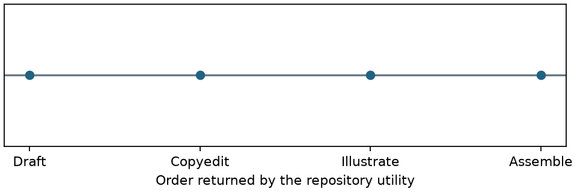

<!-- readme: curated -->

# Local dependency-ordering verification

**Version** v1.3.0 | **Status** Maintained | **Last updated** November 2026

The repository's [graph utility](../../src/codomyrmex/utils/graph.py) sorts finite lists of dependencies. The fixture checks its behavior with fictional publishing tasks. Drafting comes first, copyediting and illustration both depend on the draft, and final assembly depends on both. The replay confirms every task appears once and all prerequisites precede their dependents. It also verifies that a separate cyclic pair raises `ValueError`.



The retained figure shows the observed order. It stays available in a fresh checkout and on the documentation site. The replay generates a new figure and checks its bytes against this reference. The [fixture specification](SPEC.md) gives the acceptance conditions. The [existing Codomyrmex paper](../manuscript/README.md) retains its own source and publication process.

## Reproduce

From the repository, create a clean, detached worktree with the verification inputs. Use an absolute worktree path.

```bash
proof=/absolute/path/to/codomyrmex-graph-proof
git worktree add --detach --no-checkout "$proof" HEAD
git -C "$proof" sparse-checkout set --no-cone --stdin <<'PATHS'
/docs/verification/
/src/codomyrmex/utils/graph.py
/tests/unit/utils/test_graph.py
/tests/unit/utils/reader-*.in
PATHS
git -C "$proof" checkout --detach HEAD
```

Use Python with pytest and Matplotlib 3.11.2 for the figure comparison. Run the native tests and the replay from the isolated checkout. Use a new directory named `codomyrmex` outside the checkout for the disposable project.

```bash
project=/absolute/path/to/disposable/codomyrmex
cd "$proof"
PYTHONPATH="$PWD/src" PYTEST_DISABLE_PLUGIN_AUTOLOAD=1 \
  python -m pytest -c /dev/null --noconftest -o 'markers=unit: unit tests' tests/unit/utils/test_graph.py
python docs/verification/replay.py "$project"
printf '/output/\n' > "$project/.gitignore"
git -C "$project" init --quiet
git -C "$project" add .gitignore docs/manuscript
git -C "$project" -c user.name='Local verification' -c user.email='verification@example.invalid' \
  commit --quiet -m 'Stage source from the verification checkout'
```

The replay prepares reader inputs in the disposable project's `docs/manuscript/`, a JSON fixture record in `output/data/`, and a figure registry in `output/figures/`. From the [pinned Template checkout](https://github.com/docxology/template/tree/87704feae0a4490ef7dad9c931d268e8c30273c2) with its Python, Pandoc, and LaTeX environment, register the project and run the renderer.

```bash
ln -s "$project" projects/working/codomyrmex
uv run --no-sync python scripts/pipeline/stage_03_render.py --project working/codomyrmex
uv run --no-sync python scripts/pipeline/stage_04_validate.py --project working/codomyrmex
```

Read the combined PDF, combined HTML, and validation report under the disposable project's `output/pdf/`, `output/web/`, and `output/reports/`.

## Navigation

- [Documentation index](../README.md)
- [Native graph tests](../../tests/unit/utils/test_graph.py)
