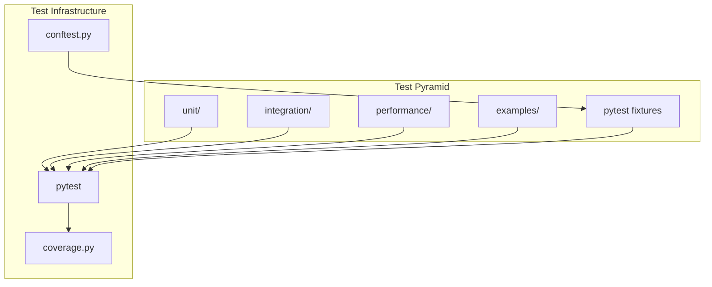

# Tests — Functional Specification

**Version**: v1.0.0 | **Status**: Active | **Last Updated**: February 2026

## Purpose

Testing directory providing comprehensive test suites following test-driven development practices with real data analysis (no mock methods). Ensures code quality, functionality, and reliability across the Codomyrmex platform.

## Design Principles

### Modularity

- Tests organized by type and module
- Independent test execution
- Clear test boundaries
- Composable test fixtures

### Internal Coherence

- Consistent test structure
- Unified assertion patterns
- Standardized fixtures
- Logical test organization

### Parsimony

- Essential test cases only
- Focused test assertions
- Minimal test setup
- Direct test implementations

### Functionality

- Real data analysis (no mocks)
- Working test scenarios
- Practical test coverage
- Actionable test results

### Testing

- Test-driven development
- Comprehensive coverage with the 60% project-wide line-coverage floor
- Unit and integration tests
- Performance benchmarks

### Documentation

- Clear test descriptions
- Documented test fixtures
- Usage examples
- Test organization guides

## Architecture

## Functional Requirements

### Test Types

1. **Unit Tests**: Individual functions and classes
2. **Integration Tests**: Cross-module workflows
3. **Performance Tests**: Benchmarking and profiling
4. **Example Tests**: Runnable examples validation
5. **Fixture Tests**: Test data and setup validation

### Test Standards

- Real data analysis (no mocks)
- 60% project-wide line coverage
- Clear test descriptions
- Independent test execution
- Fast test execution

### A test may not mutate the environment it runs in

The suite shares one virtual environment, so a test that rebuilds it destroys the
interpreter every other test is importing from. `uv run` re-resolves the project
environment against `.python-version`, and when the running interpreter differs it
**deletes and recreates `.venv`**. Measured on a 3.12 environment: 970 site-packages
entries became 165 and `lib/python3.12` was gone. A destructive test passes (its
command exits 0) and the failures land later, in unrelated modules, as
`ModuleNotFoundError` — which is what produced roughly 130 failures per 3.12+ CI leg
while 3.11 stayed green.

Two shapes are refused, and a subprocess is the only place they occur:

- `uv run` / `uv sync` without `--no-sync`, and `uv run` without `--python
  <sys.executable>` — say which interpreter you mean and do not let `.python-version`
  choose one.
- A bare interpreter name (`python`, `python3`, `python3.12`, …) as argv[0]. It runs
  whatever `PATH` resolves: a different version, a different set of extras, or on a
  fresh runner a venv nothing synced.

`tests/unit/release/test_environment_safety.py` enforces this by parsing every test
module with `ast` — a comment or docstring mentioning `--no-sync` cannot satisfy it —
and carries negative controls for each shape so the gate is shown to refuse. When a
test needs a tool from another dependency group, skip with the reason (as the
documented `mkdocs` check does) instead of syncing it.

## Quality Standards

### Test Quality

- Comprehensive coverage
- Clear test descriptions
- Real data usage
- Fast execution
- Reliable results

### Code Quality

- Follow TDD practices
- Clear test structure
- Proper fixtures
- Good assertions

## Interface Contracts

### Test Interface

- pytest-compatible test functions
- Standard fixture usage
- Consistent assertion patterns
- Clear test organization

### Fixture Interface

- Shared fixtures in conftest.py
- Module-specific fixtures
- Consistent fixture naming
- Reusable test data

## Implementation Guidelines

### Test Development

1. Write tests before implementation (TDD)
2. Use real data (no mocks)
3. Ensure comprehensive coverage
4. Keep tests fast and independent
5. Document test purpose

### Test Organization

- Organize by test type
- Group related tests
- Use descriptive names
- Share common fixtures

## Navigation

- **Human Documentation**: [README.md](README.md)
- **Technical Documentation**: [AGENTS.md](AGENTS.md)
- **Repository Root**: [../README.md](../README.md)
- **Repository SPEC**: [../SPEC.md](../SPEC.md)

<!-- Navigation Links keyword for score -->
